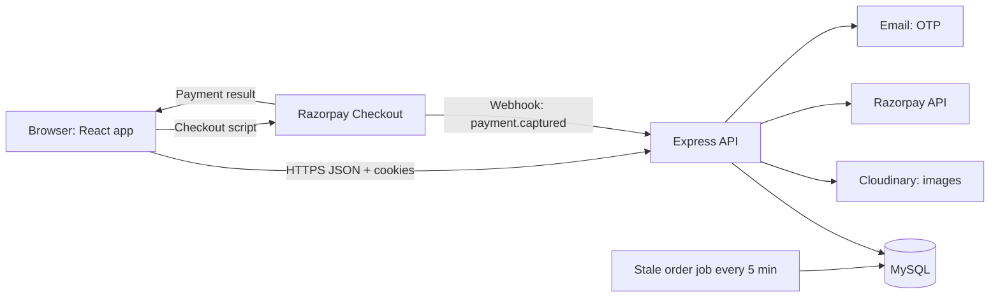
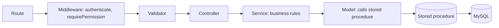
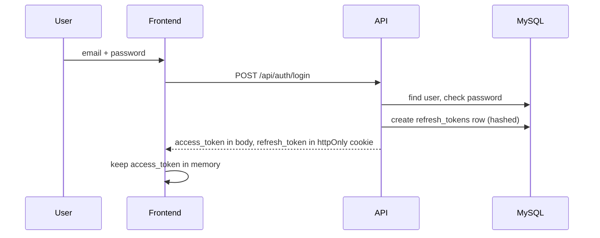
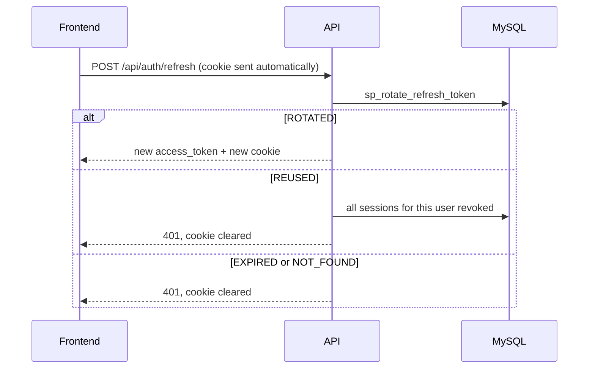
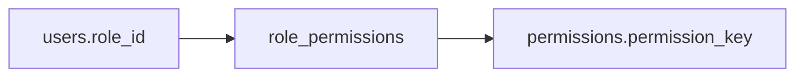
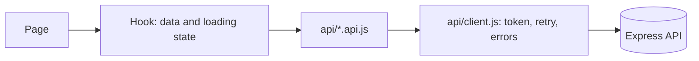
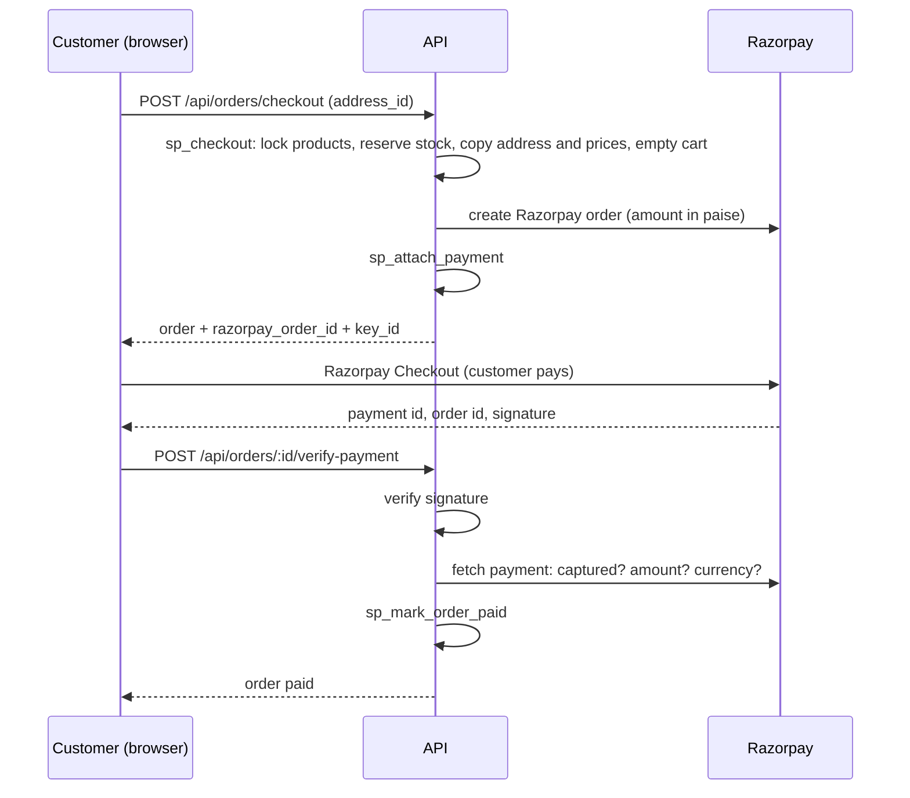
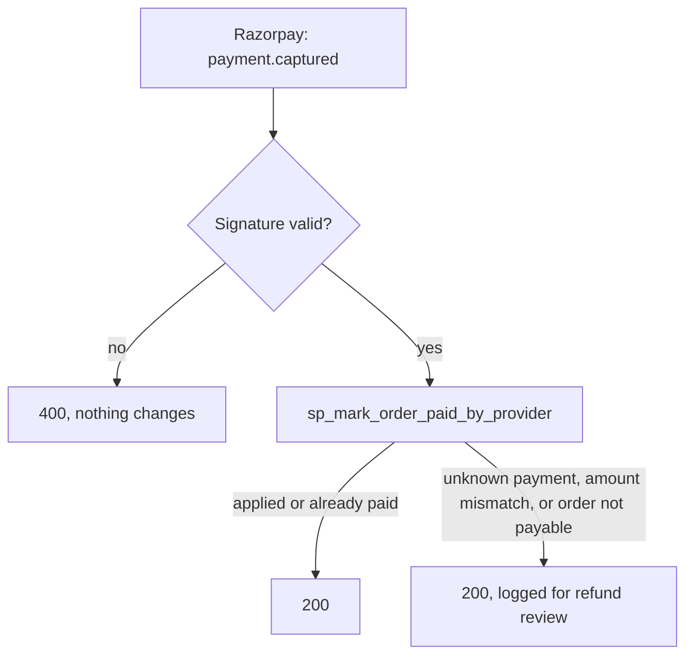
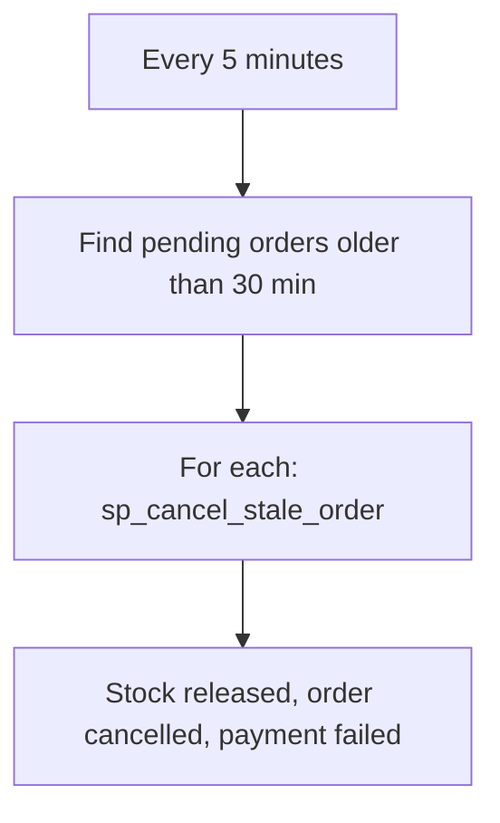

# Gearnix: Architecture

## 1. System overview



## 2. Repository layout

```text
gearnix/
├── backend/          Express API (exists)
├── frontend/         Vite + React app (Phase 1)
├── database/         SQL: tables, procedures, seeds, run in this order
└── docs/             phases, design, architecture, prd, progress, stack
```

## 3. Backend layers

Every request follows the same path:



| Layer | Responsibility | Must not |
|---|---|---|
| Route | Maps URL and method to middleware and controller | Contain logic |
| Middleware | Authentication, permissions | Know business rules |
| Validator | Checks shape and cleans input | Touch the database |
| Controller | Reads `req`, writes `res`, picks the status code | Contain business rules |
| Service | Business rules, error mapping | Read `req` or `res` |
| Model | Calls procedures | Contain rules |
| Procedure | Data changes, locks, transactions | Be called directly from routes |

**Error contract:** the service throws an `Error` with `statusCode` for expected problems. The controller turns it into this JSON:

```json
{ "success": false, "message": "Readable message" }
```

Unexpected errors return 500 with `"Internal server error"`, and the real error is logged on the server.

**Success contract:**

```json
{ "success": true, "message": "...", "data": { } }
```

Lists return `data: { items, pagination: { page, limit, total, total_pages } }`.

## 4. Authentication architecture

Two tokens:

| Token | Lifetime | Where it lives | Purpose |
|---|---|---|---|
| Access token (JWT) | 1 hour | Frontend memory only | Sent as `Authorization: Bearer` on every API call |
| Refresh token | 7 days | httpOnly cookie, path `/api/auth` | Gets a new access token; never readable by JavaScript |

Stored server-side in `refresh_tokens`: a SHA-256 hash of each refresh token, expiry, and revocation time.

### Login



### Silent refresh (page load, or after a 401)



**Rule for the frontend:** only one refresh request runs at a time. Other requests that hit a 401 wait for it and then retry.

### Logout and password change

- `POST /api/auth/logout`: ends the current session and clears the cookie
- `POST /api/auth/logout-all`: ends every session for the user
- Password change: ends every session, so other devices must log in again

## 5. Permission architecture



- The backend checks `requirePermission('product.create')` against the database on every request.
- The frontend gets the list once, from `GET /api/users/me`, and uses it to show or hide menus and pages.
- The frontend check is for display only. The backend is the security boundary.
- No role names appear in application code. Role names appear only in one-time setup scripts.

| Role | Permission keys |
|---|---|
| Customer | `cart.manage`, `wishlist.manage`, `address.manage`, `order.manage` |
| Blog Admin | `blog.read`, `blog.create`, `blog.update` |
| Product Admin | `product.read`, `product.create`, `product.update`, `category.read`, `category.create`, `category.update` |
| Super Admin | All of the above, plus `product.delete`, `category.delete`, `blog.delete`, `user.read`, `user.update_role`, `role.read`, `role.update` |

Super Admin's permissions are locked and can't be edited through the API.

## 6. Frontend architecture

```text
frontend/src/
├── main.jsx            entry point
├── App.jsx             all routes
├── api/                one file per backend module
├── auth/               AuthContext, RequireLogin, RequirePermission
├── layouts/            StoreLayout, AdminLayout
├── pages/
│   ├── public/         Landing, Products, ProductDetail, Blogs, BlogDetail, Login, Register
│   ├── customer/       Cart, Checkout, Orders, OrderDetail, Wishlist, Addresses, Profile
│   └── admin/          users, roles, categories, products, blogs
├── components/
│   ├── ui/             shadcn/ui components and wrappers
│   └── shared/         ProductCard, ImageUploader, StatusBadge
├── hooks/              useApi and other shared hooks
├── utils/              money, dates, formatting
└── constants/          permission keys, order status labels
```

**Data flow in the frontend:**



Pages never call `fetch` directly. Every call goes through `api/client.js`.

## 7. Routes

| Path | Who | Layout |
|---|---|---|
| `/` | Everyone | Store: landing page |
| `/products`, `/products/:slug` | Everyone | Store |
| `/blogs`, `/blogs/:slug` | Everyone | Store |
| `/login`, `/register` | Guests | Store |
| `/cart`, `/checkout`, `/orders`, `/orders/:id`, `/wishlist`, `/addresses`, `/profile` | Customers | Store |
| `/admin` | Anyone with an admin permission | Admin |
| `/admin/users`, `/admin/roles` | `user.read`, `role.read` | Admin |
| `/admin/categories` | `category.read` | Admin |
| `/admin/products` | `product.read` | Admin |
| `/admin/blogs` | `blog.read` | Admin |

Note: product detail URLs use the slug on the frontend. The API still accepts IDs for admin operations.

## 8. Purchase flow



If Razorpay can't be reached while creating the order, the order is cancelled and the stock is released before the error is returned.

## 9. Webhook and background jobs





The webhook route is mounted **before** `express.json()`, because the signature is checked against the raw request body.

## 10. Image handling

- Current: uploads saved to `backend/uploads/` with server-generated names, served from `/uploads`.
- Deployment: move uploads to Cloudinary. The database stores the Cloudinary URL in the same column.
- Rules: 2 MB limit per image, JPEG, PNG, or WebP only, five images per product upload, primary image enforced by the database.

## 11. Database

Tables by area:

| Area | Tables |
|---|---|
| Identity | `users`, `roles`, `permissions`, `role_permissions`, `user_role_history`, `otp_verifications`, `refresh_tokens`, `audit_logs` |
| Catalog | `categories`, `products`, `product_images` |
| Content | `blogs` |
| Customer | `addresses`, `carts`, `cart_items`, `wishlists`, `wishlist_items` |
| Orders | `orders`, `order_items`, `payments` |

Rules that live in the database:
- One current role per user
- One default address per customer
- One primary image per product
- One cart and one wishlist per user
- Unique slugs for products, categories, and blogs
- Money in `DECIMAL`, payment amounts in paise

## 12. Environment variables

| Variable | Used by | Example |
|---|---|---|
| `DB_*` | Backend | Database host, user, password, name |
| `JWT_SECRET` | Backend | Long random string |
| `JWT_EXPIRES_IN` | Backend | `1h` |
| `REFRESH_TOKEN_DAYS` | Backend | `7` |
| `CLIENT_URL` | Backend (CORS) | `http://localhost:5173` |
| `RAZORPAY_KEY_ID` | Backend | `rzp_test_...` |
| `RAZORPAY_KEY_SECRET` | Backend | Server only |
| `RAZORPAY_WEBHOOK_SECRET` | Backend | Set in the dashboard |
| `STALE_ORDER_MINUTES` | Backend | `30` |
| `VITE_API_URL` | Frontend | `http://localhost:5000/api` |
| `VITE_RAZORPAY_KEY_ID` | Frontend | Same as `RAZORPAY_KEY_ID` (public) |

Secrets never appear in the frontend, in responses, or in logs.